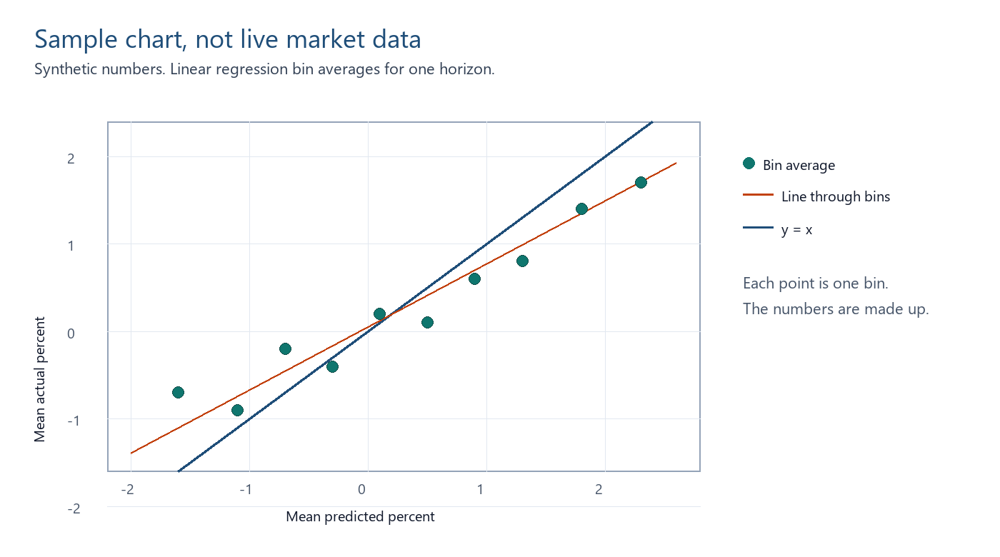

# Stock Portfolio ML



The picture above is a sample drawn from made-up numbers. It is not live market data.

This is a Windows app for a watchlist of 25 large U.S. stocks. It saves Alpaca IEX prices in a SQLite file on your PC and opens a dashboard. You can record share counts, look at charts, and open five machine-learning pages.

https://github.com/hercandres/stock-portfolio-ml

## Data

The stock list is in `data_collection\universe.py`. Prices come from Alpaca's free IEX feed.

- Minute bars cover about the last year. The stock charts use them. When a new minute is saved, that stock's minute from about a year earlier is removed.
- Daily bars are what the models train on. They are kept. The one-year limit does not delete them.

`database\stock_market.db` and `machine_learning\exports\random_forest_features.csv` are created on your PC the first time you run the app. They are not in this repo. Model scores under `machine_learning\outputs` are not in the repo either. Do not commit them.

## Dashboard

The sidebar starts with Portfolio, Stock, and Database. Under ML Methods the pages are:

1. Random Forest
2. XGBoost
3. Linear Regression
4. K-Means
5. PCA

Random Forest, XGBoost, and Linear Regression guess the percent change 1, 5, and 20 trading days ahead. K-Means groups similar days. PCA summarizes the same daily numbers. The models run when the dashboard opens. Each page has its own button to run again.

## Run it on Windows

Use Python 3.14.

Open PowerShell in this folder:

```powershell
py -3.14 -m venv .venv
.\.venv\Scripts\python.exe -m pip install -r requirements.txt
copy .env.example .env
```

Open `.env` and fill in your own Alpaca values for these names. This page does not include any key values.

- `APCA_API_KEY_ID`
- `APCA_API_SECRET_KEY`

Create the keys in the Alpaca dashboard, under API Keys. Paper and live keys use those same two names. Do not commit `.env`.

Then create the empty database and start the app:

```powershell
.\.venv\Scripts\python.exe -m database.initialize
```

Double-click `Start Portfolio.bat`.

That window starts the dashboard and the IEX updates. The first launch downloads minute bars and daily bars, then the dashboard builds the feature file locally. Close the window to stop both. It does not install a Windows service.

If `py -3.14` is not found, install Python 3.14 from python.org and check "Add python.exe to PATH", then run the commands again.
